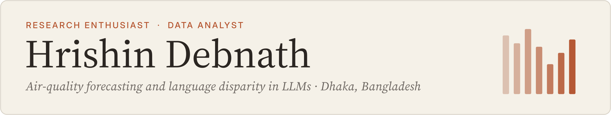
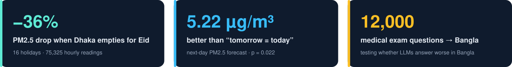

  

  
  
  
  

Hi, I'm Hrishin. I'm a higher-secondary science student in Dhaka who turns public data into research. I have written two air-quality papers on my own, both now under review, and I'm testing whether language models answer medical questions worse in Bangla than in English.

  

## 🔬 Research

<table>
<tr>
<td width="50%" valign="top">

**Does Dhaka's air get cleaner when the city empties?** 
Sole author · under review at the <i>Columbia Junior Science Journal</i>

Eid empties Dhaka every year, which makes it a natural experiment. Across 16 Eid holidays (2016–2024) and 75,325 hourly readings from the US Embassy monitor, PM2.5 fell by **36%**.

[Code and data →](https://github.com/hrishinthecoder/dhaka-eid-pm25)

</td>
<td width="50%" valign="top">

**Next-day PM2.5 forecasting in Dhaka** 
Sole author · under review at <i>Air Quality, Atmosphere &amp; Health</i>

I built two independent pipelines from a single reference-grade monitor, ERA5 weather and satellite fire data. XGBoost beat the "tomorrow = today" baseline by **5.22 µg/m³** RMSE (p = 0.022), and a separate LightGBM build reached the same result.

[Code, frozen model and checksums →](https://github.com/hrishinthecoder/dhaka-pm25-forecast)

</td>
</tr>
</table>

## 🌱 What I'm doing now

- **Research intern, CreateBud Inc.** I'm building a Bangla version of the MedQA medical exam set (12,000 questions) to measure whether LLMs answer worse in Bangla than in English.
- **Market analyst, VibeWeave.** Market studies of India's textile industry and a verified database of 26 clothing manufacturers.
- **Deputy Director of R&D, CORViS.** I run the *Speaks Academia* seminar series.
- **Next:** language disparity in LLMs, and whether image-generation models do worse with Bangla prompts.

## 📂 Selected projects

| Project | What it shows | Tools |
|---|---|---|
| [**dhaka-eid-pm25**](https://github.com/hrishinthecoder/dhaka-eid-pm25) | Event study, bootstrap CIs, placebo tests and weather control on 9 years of hourly data | Python, pandas, SciPy |
| [**dhaka-pm25-forecast**](https://github.com/hrishinthecoder/dhaka-pm25-forecast) | Leak-free forecasting, Diebold–Mariano test, rolling backtest, SHAP, frozen artifacts | Python, XGBoost, LightGBM |
| [**Saas_Cohort_Model**](https://github.com/hrishinthecoder/Saas_Cohort_Model) | Customer retention falls to ~70% by month 12 while revenue retention holds near 95%; Monte Carlo NRR range 83–110% | Excel, Power Query, DAX |
| [**elevvo-pathways-internship**](https://github.com/hrishinthecoder/elevvo-pathways-internship) | RFM segmentation of 1,998 customers: 306 "Champions" made 23.81% of revenue | Python |
| [**bellabeat_case_study**](https://github.com/hrishinthecoder/bellabeat_case_study) | Google Data Analytics capstone: smart-device habits turned into marketing advice | R, SQL |
| [**Olympic-Dashboard**](https://github.com/hrishinthecoder/Olympic-Dashboard) | Interactive dashboard of medals, countries and sports over time | Python |

## 🧰 Toolbox

  
  
  
  
  
  
  
  
  
  
  
  

**Certificates:** WorldQuant University Applied Data Science Lab · Google Data Analytics · Google Business Intelligence · HackerRank SQL (Advanced) · freeCodeCamp Data Analysis with Python

Dhaka, Bangladesh · UTC+6

